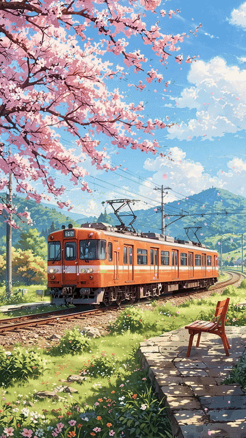
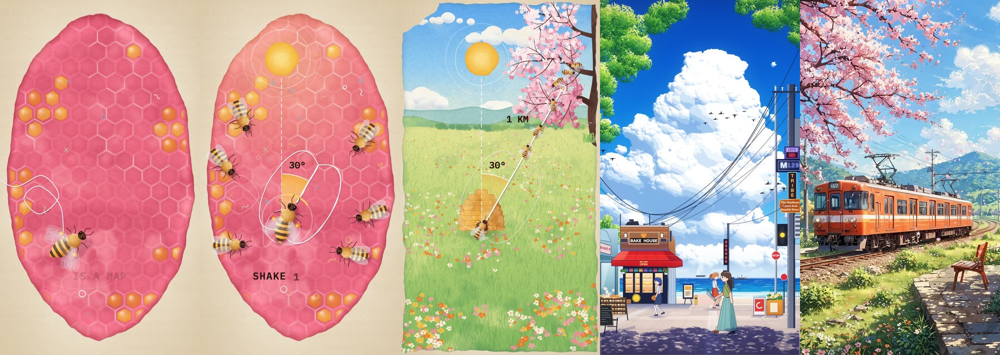

# animate

A [Claude Code](https://claude.com/claude-code) skill that makes short animated films entirely in code, soundtrack included.

Give it reference images or videos and a rough idea. It studies the style, plans the shots, draws every frame, writes the music, checks its own work and hands you an MP4. No AI video model, no animator.

<p align="center">
  
</p>

<p align="center">
  Animated from <a href="docs/train-still.jpg">this still image</a>. <a href="examples/moving-image/train-animated.mp4">Watch it in full quality</a>.
</p>

More frames from films made with this skill:



## What it can do

- **Animate an image:** cut a picture into layers and bring it to life, like the train above.
- **Repaint a scene:** redraw a reference as a moving scene.
- **Make a new film:** take a topic or story and animate it in the look of your references.

It works best on illustrated styles: watercolour, line art, paper cut, risograph, flat vector, anime backgrounds. It isn't for photorealism, and it's weak at acting faces.

## Install

The easy way is to paste this into Claude Code:

```text
Install the skill from https://github.com/JAYANTCH1797/animate-skill into ~/.claude/skills/animate, set up its Python packages in a .venv inside that folder, and make sure ffmpeg is installed.
```

Or do it yourself. You need Python 3, [ffmpeg](https://ffmpeg.org) and Google Chrome.

```bash
git clone https://github.com/JAYANTCH1797/animate-skill ~/.claude/skills/animate
```

```bash
cd ~/.claude/skills/animate && python3 -m venv .venv && .venv/bin/pip install -r requirements.txt
```

No Chrome? Run `.venv/bin/playwright install chromium` as well.

## Use it

Start a new Claude Code session, attach your references, and type:

```text
/animate a 15-second vertical explainer on how octopuses think, in the style of these references
```

Set effort to high. A full film can take around an hour, because it reviews and redraws its own work. Your project ends up in `animations/<name>/`, with the MP4 in `out/`.

## Tips

- Pick references with a clear style. More references are fine, as the skill gives each one a job, like texture from one and pacing from another.
- Name the part you like: "the first 12 seconds of this reel".
- Ask for changes afterwards: the skill ends with a few specific tweaks you can request.
- Claude can't hear the soundtrack or watch at full speed, so check both yourself.
- Use references you have the right to use, and take the style rather than copying someone's work.

## What's inside

| Folder | What it holds |
| --- | --- |
| `SKILL.md` | The process Claude follows |
| `scripts/` | Study references, render, make the soundtrack, mix, check quality |
| `references/` | Style recipes and how to animate an image |
| `examples/` | Source for finished work to learn from |
| `assets/` | A starter template and two open-licensed fonts |

## Licence

MIT, except the fonts in `assets/fonts/`, which keep their SIL Open Font Licence.

Made by [@clawed_irl](https://www.instagram.com/clawed_irl/). This is an independent project, not made or endorsed by Anthropic.
